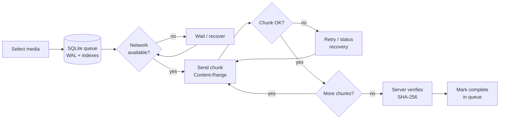
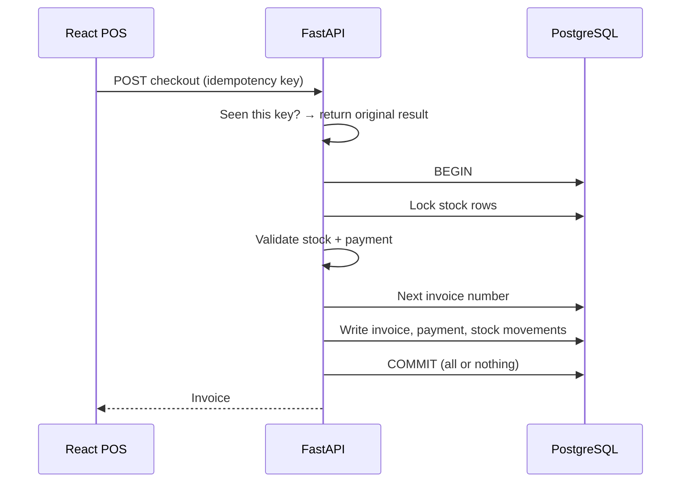
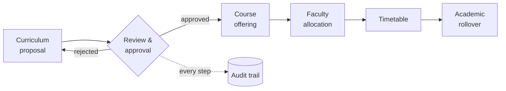

<!-- Profile README for github.com/kasi868 -->

  

  
  
  

  <b>Software Engineer</b> with 2+ years building web and mobile applications. 
  <b>React</b> and <b>React Native</b> on the front, <b>Python / FastAPI</b> services on the back, <b>PostgreSQL</b> underneath — 
  focused on the parts that make software reliable: transactions, retries, validation, and the edge cases that break real apps.

## ◆ About Me

I'm a **Full Stack Developer at KRGY Infotech**, where I work across the whole application stack — from **PostgreSQL** data models and **FastAPI** services to **React** and **React Native** interfaces, all running in **Docker**-based environments. Before that, I spent a year and a half at **Maxzen Tech** as a **Mobile Application Developer**, building React Native features, reusable UI components, and fixing Android build issues in Android Studio.

Most of my work sits where things are most likely to go wrong:

- **💳 Money and stock** — transaction-safe checkout with row locking, idempotency, document sequencing, payment validation and atomic inventory updates, so invoices, payments and inventory always agree.
- **📶 Unreliable networks** — resumable chunked uploads with SHA-256 verification, persistent SQLite queues, retries and background sync, so large files finish uploading even when the connection doesn't cooperate.
- **🔐 Who can do what** — authentication, role-based access control and scope-aware authorization, backed by audit trails.
- **🐞 Bugs nobody can explain** — I troubleshoot across frontend, backend, database, network and mobile layers to find the root cause, not just the symptom.

I care about writing **clear, maintainable code**, handling **errors and edge cases** deliberately, and thinking about how a feature should be **tested** before calling it done.

<table>
  <tr>
    <td align="center" width="25%"><b>2+ years</b> professional experience</td>
    <td align="center" width="25%"><b>Web + Mobile</b> React · React Native</td>
    <td align="center" width="25%"><b>Backend</b> Python · FastAPI · REST</td>
    <td align="center" width="25%"><b>3 certifications</b> PCAP · AWS · SQL</td>
  </tr>
</table>

  📍 Kakinada, Andhra Pradesh, India &nbsp;·&nbsp; 💬 Open to Software Engineer, Full Stack and Mobile Developer roles

 

## ◆ What I Do

<table>
  <tr>
    <td width="33%" valign="top">
      <h3>⚙️ Software Engineer</h3>
      
        • Debugging and root-cause analysis across frontend, backend, database and network layers 
        • Data consistency with transactions, row locking and idempotency 
        • Defensive error handling and input validation 
        • Clear separation of responsibilities between layers
      
    </td>
    <td width="33%" valign="top">
      <h3>🧩 Full Stack Developer</h3>
      
        • React.js interfaces backed by FastAPI REST services 
        • PostgreSQL models for inventory, billing and payment workflows 
        • Authentication, authorization and role-based access control 
        • Docker-based development environments
      
    </td>
    <td width="33%" valign="top">
      <h3>📱 Mobile Developer</h3>
      
        • React Native apps for Android and iOS 
        • Resumable chunked uploads with SHA-256 verification 
        • Persistent SQLite queues with background sync 
        • Android builds, foreground services and debugging
      
    </td>
  </tr>
</table>

## ◆ Tech Stack

<table>
  <tr>
    <td width="130"><b>Languages</b></td>
    <td>
       
      
    </td>
  </tr>
  <tr>
    <td><b>Frontend</b></td>
    <td>
       
      
      
      
    </td>
  </tr>
  <tr>
    <td><b>Mobile</b></td>
    <td>
       
      
      
      
      
      
      
      
    </td>
  </tr>
  <tr>
    <td><b>Backend</b></td>
    <td>
       
      
      
      
      
    </td>
  </tr>
  <tr>
    <td><b>Databases</b></td>
    <td>
       
      
      
      
    </td>
  </tr>
  <tr>
    <td><b>Tools</b></td>
    <td>
       
      
      
    </td>
  </tr>
</table>

---

## ◆ Featured Projects

<!-- ───────────────────────── GALLERY HUB ───────────────────────── -->

### 📦 Gallery Hub — Mobile Media Backup App

A React Native app for managing and backing up photos and videos on Android and iOS, with a resumable upload pipeline built for unreliable mobile networks.

> **🎯 The problem** 
> Phone videos are large, and mobile networks are not. A single-request upload of a multi-gigabyte video fails the moment the signal drops, the app is closed, or the OS kills it in the background — and the user has to start over. A backup app has to finish the job eventually, without corrupting files or duplicating work.

**🛠️ What I built**
- A **resumable upload pipeline** that sends large videos in **4 MiB chunks** using `Content-Range`, so an interrupted upload continues from where it stopped
- **SHA-256 verification** so the server confirms a reassembled file is byte-for-byte correct
- **Status recovery and retries** — the client re-syncs upload progress with the server after a failure instead of guessing
- A **persistent SQLite upload queue** (26 tracked fields per item) using **WAL** and **indexes**, with network recovery, cancellation, and **adaptive 1–8 MiB chunk sizing**
- **Android foreground backup** and background processing so uploads keep running outside the app screen
- **Authenticated video playback** and **media caching** for viewing backed-up media

**🧠 Engineering challenges → how I approached them**

| Challenge | Approach |
|---|---|
| Connection drops halfway through a large video | Split into 4 MiB chunks with `Content-Range`; only the missing chunks are re-sent |
| How do we know the final file isn't corrupted? | SHA-256 checksum verified before the upload is accepted |
| App is closed or the phone restarts mid-backup | Upload state lives in a persistent SQLite queue, not in memory |
| Queue writes slowing down the UI | SQLite WAL mode lets reads and writes run without blocking each other; indexes keep pending-item lookups fast |
| Same chunk size doesn't suit every network | Adaptive chunk sizing between 1 and 8 MiB |
| Android stops background work | Foreground backup service for long-running uploads |
| User changes their mind | Cancellation that cleans up queue state |

<b>📐 Upload flow</b>

<b>🧪 Test scenarios this design must pass</b>

- Kill network mid-upload → upload resumes from the last confirmed chunk, not from zero
- Force-close the app during backup → queue item survives restart and continues
- Cancel an in-progress upload → no orphaned queue rows or partial server files
- Tamper with a chunk → SHA-256 check rejects the file
- Unauthenticated playback request → access denied

Scenario checklist for the design — not a report of automated test results.

 

<!-- ───────────────────────── ERP + POS ───────────────────────── -->

### 🧾 ERP + POS — Retail ERP and Point of Sale System

A retail platform covering products, inventory, billing, payments, returns and reporting, with a checkout designed to stay correct under concurrent use.

> **🎯 The problem** 
> In retail, the checkout is where money and stock change hands — so it is where bugs cost the most. Two cashiers selling the last unit at the same time, a customer double-tapping "Pay", or a crash between charging the payment and reducing stock can leave invoices, payments and inventory disagreeing with each other.

**🛠️ What I built**
- ERP + POS modules for **products, inventory, billing, payments, returns and reporting**
- React.js frontend workflows integrated with FastAPI REST APIs and PostgreSQL data services
- A **transaction-safe checkout** combining row locking, idempotency, document sequencing, payment validation and atomic inventory updates
- **Role-based access control**, **stock movement tracking**, **returns/refunds**, **damaged inventory** handling and **audit controls** for outlet-level operations

**🧠 Engineering challenges → how I approached them**

| Challenge | Approach |
|---|---|
| Two checkouts reduce the same stock at once | **Row locking** on stock rows so concurrent sales are serialised |
| Retry or double-click creates a duplicate sale | **Idempotency** — the same request is processed only once |
| Invoice numbers skipping or repeating | **Document sequencing** for invoice numbering |
| Payment amount doesn't match the bill | **Payment validation** before the sale is committed |
| Crash halfway leaves stock and invoice out of sync | **Atomic inventory updates** — the whole checkout commits or none of it does |
| Not every staff member should refund or adjust stock | **RBAC** on sensitive operations |
| "Where did this stock go?" | **Stock movement tracking** + **audit controls**; damaged inventory and returns recorded as explicit movements |

<b>📐 Checkout flow</b>

<b>🧪 Test scenarios this design must pass</b>

- Two concurrent checkouts for the last unit → exactly one succeeds
- Same checkout request sent twice → one invoice, one payment
- Payment amount below bill total → rejected, no stock change
- Failure mid-checkout → no partial invoice or stock change
- Cashier role attempts a refund without permission → denied and audited

Scenario checklist for the design — not a report of automated test results.

  
  

 

<!-- ───────────────────────── ICMS ───────────────────────── -->

### 🎓 ICMS — Integrated College Management System

A college management platform for academic and administrative operations, built around governance workflows, scoped permissions and auditability.

> **🎯 The problem** 
> A college runs on decisions that pass through several people — a curriculum change is proposed, reviewed and approved before it becomes a course offering, faculty allocation or timetable. Each person may only act within their own scope, every change needs a trail, and at the end of the year the whole academic structure has to roll forward without breaking history.

**🛠️ What I built**
- Frontend and backend workflows for **authorization** and **scope-aware operations**
- **Governance workflows** for curriculum proposals, course offerings, faculty allocation, timetable changes, academic rollover and approvals
- **Dashboards** and **audit-oriented actions** for administrative visibility

**🧠 Engineering challenges → how I approached them**

| Challenge | Approach |
|---|---|
| Users must act only within the scope they're responsible for | **Scope-aware authorization** checked on operations, not just on screens |
| Changes shouldn't take effect without review | **Approval workflows** — proposals move through defined states before applying |
| Curriculum → offering → faculty → timetable all depend on each other | Workflows model each step separately so changes flow in order |
| Moving to a new academic year | **Academic rollover** workflow |
| "Who changed this, and when?" | **Audit-oriented actions** on governance operations |

<b>📐 Governance flow</b>

<b>🧪 Test scenarios this design must pass</b>

- User acts outside their scope → request denied at the API, not just hidden in UI
- Unapproved proposal → cannot become a course offering
- Rejected proposal → returns to draft with history preserved
- Rollover → new term created without altering previous term records
- Every approval / change → audit entry recorded

Scenario checklist for the design — not a report of automated test results.

---

## ◆ Testing & Quality Mindset

<table>
  <tr>
    <td width="50%" valign="top">
      <b>Backend</b> 
      Validation and error-response paths · auth and permission checks · transaction and concurrency edge cases · positive, negative and boundary inputs
    </td>
    <td width="50%" valign="top">
      <b>Mobile</b> 
      Network interruption and retry · upload cancel and resume · queue persistence across restarts · form validation · Android build verification
    </td>
  </tr>
  <tr>
    <td valign="top">
      <b>Web</b> 
      Form validation and error states · API integration · auth flows · regression checks on existing features
    </td>
    <td valign="top">
      <b>End-to-end workflows</b> 
      Checkout → payment → stock update · select → upload → recover → play · proposal → approval → offering
    </td>
  </tr>
</table>

## ◆ Experience

<table>
  <tr>
    <td width="72%" valign="top">
      <b>Full Stack Developer</b> · KRGY Infotech Pvt Ltd 
      
        • Develop and maintain web and mobile apps with React.js, React Native, Python and FastAPI 
        • Integrate REST APIs with authentication, authorization, validation and error handling 
        • Backend workflows for inventory, billing, payments, reporting and RBAC 
        • Transactional data consistency, invoice generation, resumable uploads and background sync 
        • Troubleshoot issues across frontend, backend, database, network and mobile layers
      
    </td>
    <td align="right" valign="top">Dec 2025 – Present</td>
  </tr>
  <tr>
    <td valign="top">
      <b>Mobile Application Developer</b> · Maxzen Tech, Hyderabad 
      
        • Built mobile features and reusable UI components with React Native and JavaScript 
        • Integrated REST APIs for authentication, data retrieval and backend communication 
        • Implemented form validation, screen navigation and error handling 
        • Tested and debugged features; resolved Android build issues in Android Studio 
        • Git and GitHub for version control
      
    </td>
    <td align="right" valign="top">Jun 2024 – Nov 2025</td>
  </tr>
</table>

## ◆ Certifications & Education

  
  
  

🎓 **B.Tech, Computer Science** — Aditya College of Engineering and Technology · Jun 2020 – May 2024

## ◆ GitHub Activity

  
  

Public-repo activity only — much of my professional work lives in private repositories.

